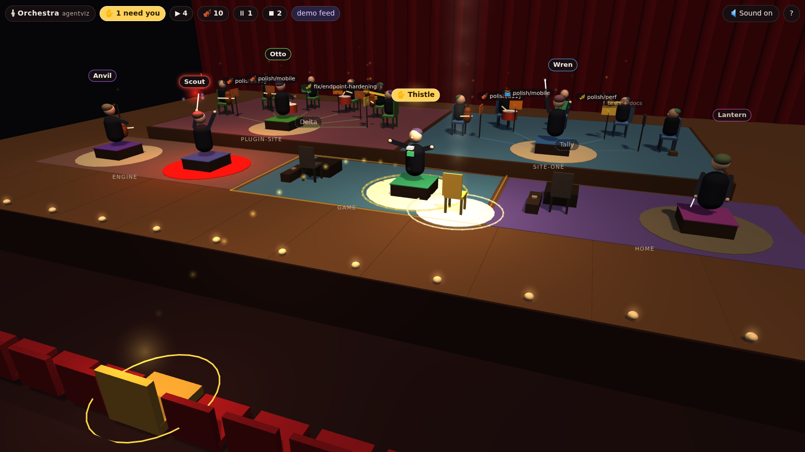
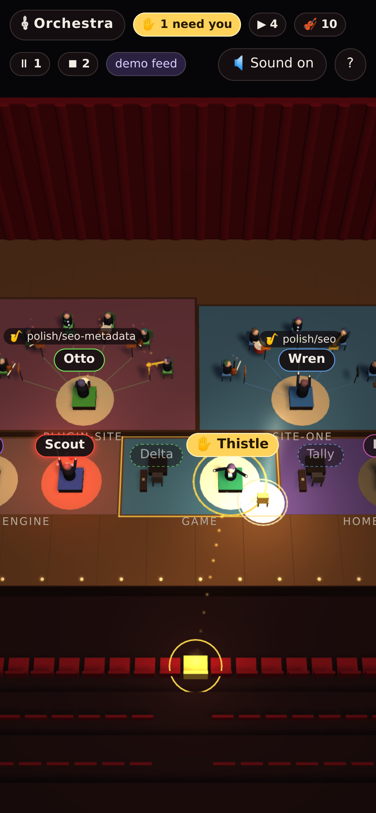

# agentviz-orchestra

Claude Code sessions as a concert stage, drawn with
[Strata](https://github.com/Preponderous-Software/strata)'s web kit. One of the
[agentviz](https://github.com/dmccoystephenson/agentviz) family: same feed, a
different way of looking at it.

Each repo is an **ensemble** on its own coloured rug. Each session is a
**conductor** on a podium under a spotlight, and its subagents are
**musicians** fanned out in front of it, each at a music stand that names its
lane. What an agent is doing decides which **instrument** it plays. When a
session needs you, a spotlight snaps onto an empty solo chair and the
conductor turns round to face your gold seat in the front row.


*The whole stage from the house (fixture feed). Front row, left to right: Anvil playing strings alone, Scout
holding a pause (and stalled, so the red flash), Thistle turned to the audience under the gold spotlight
because it needs you, Delta and Tally offline (empty chairs and closed cases), Lantern idle. Behind: Otto's
and Wren's ensembles of six and five musicians.*

## What it shows

| On stage | Means | Close-up |
|---|---|---|
| Coloured rug, name at its front edge | an ensemble: one working directory (repo) | [hero](docs/media/hero.png) |
| Conductor on a podium, warm spotlight pool | a session; its sash and its musicians' chairs share one colour | [lead](docs/media/closeup-lead.png) |
| Musicians in a fan in front of the podium, a faint thread from each stand to the podium | that session's subagents; the stand's label is the lane | [lead](docs/media/closeup-lead.png) |
| 🎻 strings, a cello with the bow moving | `edit`: editing / writing files | [lead](docs/media/closeup-lead.png) |
| 🥁 percussion, sticks hitting a drum, a spark on each hit | `run`: running commands | [lead](docs/media/closeup-lead.png) |
| 🎷 woodwinds, a clarinet, green notes | `read`: reading, searching | [lead](docs/media/closeup-lead.png) |
| 🎺 brass, a raised horn with a gold bell | `web`: web search / fetch | [lead](docs/media/closeup-lead.png) |
| 🪄 the baton sweeping a beat pattern | `delegate`: directing subagents | [resting](docs/media/closeup-resting.png) |
| 𝄐 hands held up, still, three lavender dots | `think`: the conductor's pause | [stalled](docs/media/closeup-stalled.png) |
| 🔔 a triangle and beater | `other` tools (MCP, skills, todo lists) | |
| The stand's plate lights up in the family colour, notes drift up | playing right now | [lead](docs/media/closeup-lead.png) |
| Instrument on the floor, stand dark | idle session, or a resting subagent (quiet for 2+ min) | [resting](docs/media/closeup-resting.png) |
| **Gold spotlight on an empty solo chair, conductor turned to face the gold seat in the front row, pulsing rings, a trail of light to that seat, the rug edge pulsing, a gold "✋ needs you" chip at the top** | **`waiting`: the session needs you** (a permission prompt or a question) | [waiting](docs/media/closeup-waiting.png) |
| Empty chair, a closed instrument case, no spotlight | `offline` | [idle + offline](docs/media/closeup-idle-offline.png) |
| A red flash on the podium and a red wrong note | `stalled`: busy but nothing written for 5 minutes | [stalled](docs/media/closeup-stalled.png) |
| White ring | the selected agent | [panel](docs/media/panel-desktop.png) |

### Close-ups


*A lead with its subagents: Otto (running a command) and six musicians fanned in front of the podium. Strings
bowing on the a11y, mobile and ux-states lanes, woodwinds on seo-metadata, percussion on performance, brass on
endpoint-hardening. Each stand names its lane and is tied back to the podium by a faint thread.*


*Needs you: Thistle has turned away from the stage towards the owner's gold seat (bottom left), arms open. The
solo chair beside the podium sits in a bright spotlight, rings pulse round both, a trail of light runs out to the
seat and the ensemble's rug edge pulses gold.*


*Idle and offline: Lantern (right) stands with arms by its sides and the baton lowered under a dim pool. Tally
(centre) is offline: an empty chair and a closed instrument case, no spotlight.*


*A resting subagent: in Wren's ensemble the "tests + docs" musician (right) has put the instrument on the floor
and its stand is dark, while the others play and Wren beats time with the baton.*


*Stalled: Scout is busy but has written nothing for over five minutes, so its podium flashes red with a red wrong
note above it. Its hands are held up still: a thinking pause.*

### Two more angles


*From the wings, low: the risers step up for the back row.*


*From above: each ensemble's fan, its stands and threads read as one group.*

### Selecting an agent


*Tap or click any conductor, musician or empty chair: the panel shows its name, state, what it is doing
(instrument family plus the tool's label), branch and repo, and for a conductor every musician (tap one to jump
to it).*

<p>


</p>

*On a phone (390 x 844): the panel is a bottom sheet (left, open on Thistle, which needs you); drag to orbit,
pinch to zoom, two fingers to pan.*

### Motion


*Five seconds of Otto's and Wren's ensembles: bows moving, sticks hitting, notes rising, Wren's baton beating.*

## Sound (off by default)

Press **Sound on** (top right) to hear the orchestra. Nothing plays, and no
audio context is created, until you do. Then each new tool call plays one
short, soft note in its family's timbre (bowed strings, a soft drum, a breathy
woodwind, a brass swell, a small bell for the baton, a plucked triangle for
other tools), pitched on a pentatonic scale so it never clashes. While anyone
needs you, a gentle two-note chime repeats every six seconds. Notes are
rate-limited (at most six in three seconds) and quiet. On the demo feed the
busy agents "call" on their own slow beat so there is something to hear.

## Run

```bash
python3 -m vendor.agentfeed serve --web web --port 8849            # your live sessions
python3 -m vendor.agentfeed serve --web web --port 8849 --fixture  # the demo feed
```

Open `http://127.0.0.1:8849/` (the server binds to 127.0.0.1 only: the feed
describes real work on this machine). `?fixture=1` shows the demo feed from a
live server, `?fps=1` the kit's frame stats. The page polls `/api/agents` every
2 s and eases every figure between snapshots.

## Build

The built scene (`web/orchestra-engine.js`, `.wasm`) and the kit scripts are
committed, so running needs only Python. To rebuild after editing
`scene/main.cpp` (emsdk 6.0.11 at `/root/emsdk`, about 25 s):

```bash
scene/build.sh    # downloads Strata 0.10.0 into .strata/ once, checks its SHA-256
```

## Test

```bash
python3 -m unittest discover -s tests                              # serves the fixture, checks page, assets, feed
NODE_PATH=/root/arcade-watch/node_modules node tests/smoke.cjs     # headless Chromium: draws, tap selects, no errors
NODE_PATH=/root/arcade-watch/node_modules node tests/screenshots.cjs  # regenerates every image in docs/media/
```

The tests use port 8949. Every image here comes from the fixture feed, never
from live sessions.

## Layout

| Path | What |
|---|---|
| `scene/main.cpp` | the Strata scene: hall, rugs, podiums, chairs, stands, instruments, spotlights |
| `scene/kit.conf`, `scene/build.sh` | the web-kit build |
| `web/index.html` | page, HUD, legend, panel / bottom sheet |
| `web/orchestra.js` | feed polling, stage layout, easing, labels, picking, panel |
| `web/orchestra-audio.js` | the opt-in Web Audio band |
| `vendor/agentfeed/` | the shared feed, vendored from agentviz (do not edit) |
