# agentviz-orchestra

Your Claude Code sessions as a concert stage, drawn with
[Strata](https://github.com/Preponderous-Software/strata)'s web kit. One of the
[agentviz](https://github.com/dmccoystephenson/agentviz) family: same feed, a
different way of looking at it.

Each repo is an **ensemble** on its own coloured rug. Each session is a
**conductor** on a podium under a spotlight, and its subagents are
**musicians** fanned out in front of it, each at a music stand that names its
lane. What an agent is doing decides which **instrument** it plays, and every
new tool call pops a bright note out of it. When a session needs you, a
spotlight snaps onto an empty solo chair and the conductor turns round to
face your gold seat in the front row, with a "?" over its head for a question
or a padlock for a permission prompt.

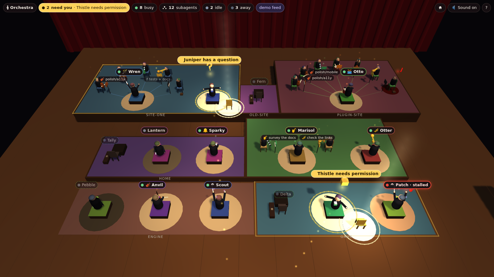
*The whole stage (demo feed). Back row: Wren's ensemble of five and Juniper (a question, gold spotlight) in
`site-one`, Fern's empty chair in `old-site`, Otto's ensemble of seven in `plugin-site`. Middle: Tally, Lantern
and Sparky at home, Marisol with two musicians and Otter in `docs`. Front: Pebble (dim), Anvil and Scout in
`engine`; Delta's empty chair, Thistle (a permission prompt) and Patch (stalled, red name) in `game`.*

## Run

Needs Python 3.8 or newer and nothing else:

```bash
git clone https://github.com/dmccoystephenson/agentviz-orchestra
cd agentviz-orchestra
python3 -m vendor.agentfeed serve --web web --port 8849            # your live sessions
python3 -m vendor.agentfeed serve --web web --port 8849 --fixture  # the demo feed
```

Open <http://127.0.0.1:8849/> (the server binds 127.0.0.1 only and refuses
non-local `Host` headers). Live mode reads your Claude Code session files
under `~/.claude` and shows session names, states, git branches, tool names
and short labels (a file's basename, a Bash command's own description, a web
host, a subagent's description), never file contents, commands or prompts;
see the agentviz [SECURITY.md](https://github.com/dmccoystephenson/agentviz/blob/main/SECURITY.md).
Query options: `?fixture=1` (demo feed), `?fps=1` (frame stats).

Drag to orbit, right-drag or two fingers to pan, wheel or pinch to zoom. Tap a
conductor, musician or empty chair for its card (a bottom sheet on a phone;
swipe it down or tap the cross to close); if the card would cover what you
tapped, the view slides it into the clear part of the screen. A busy
conductor's label leads with its instrument, and a stalled agent's label says
"stalled" in red. The gold **need you** chip names
who is waiting and why, flies the camera there and cycles through them; the
house button recentres; **?** opens the legend. If the feed stops answering,
a banner says so and the last snapshot stays; with no sessions at all, a hint
says how to start.

## What it shows

| On stage | Means | Close-up |
|---|---|---|
| Coloured rug, name at its front edge | an ensemble: one working directory (repo) | [hero](docs/media/hero.png) |
| Conductor on a podium, warm spotlight pool | a session; its sash and its musicians' chairs share one colour | [lead](docs/media/closeup-lead.png) |
| Musicians in a fan in front of the podium, a faint thread from each stand to the podium | that session's subagents; the stand's label is the lane | [lead](docs/media/closeup-lead.png) |
| A pile of score pages on the stand | grows with the agent's tool count | [lead](docs/media/closeup-lead.png) |
| 🎻 strings, a cello with the bow moving | `edit`: editing / writing files | [lead](docs/media/closeup-lead.png) |
| 🥁 percussion, sticks hitting a drum, a spark on each hit | `run`: running commands | [lead](docs/media/closeup-lead.png) |
| 🎷 woodwinds, a clarinet, green notes | `read`: reading, searching | [lead](docs/media/closeup-lead.png) |
| 🎺 brass, a raised horn with a gold bell | `web`: web search / fetch | [lead](docs/media/closeup-lead.png) |
| 🪄 the baton sweeping a beat pattern | `delegate`: directing subagents | [resting](docs/media/closeup-resting.png) |
| 𝄐 hands held up, still, three lavender dots | `think`: the conductor's pause | [stalled](docs/media/closeup-stalled.png) |
| 🔔 a triangle and beater | `other` tools (MCP, skills, todo lists) | |
| A bright note pops up and fades, the stand's plate flashes | **one new tool call** (the session's `lastToolAt` moved, or a subagent's `toolCount` rose) | [call](docs/media/closeup-call.png) |
| The stand's plate lights up in the family colour, notes drift up | playing right now | [lead](docs/media/closeup-lead.png) |
| Instrument on the floor, stand dark | idle session, or a resting subagent | [resting](docs/media/closeup-resting.png) |
| **Gold spotlight on an empty solo chair, conductor turned to face the gold seat in the front row, pulsing rings, a trail of light to that seat, the rug edge pulsing, a gold "need you" chip at the top** | **`waiting`: the session needs you** | [waiting](docs/media/closeup-waiting.png) |
| A gold padlock / a gold "?" over the waiting conductor; its label says "needs permission" / "has a question" | why it waits: a permission prompt / a question | [waiting](docs/media/closeup-waiting.png), [question](docs/media/closeup-question.png) |
| Empty chair, a closed instrument case, no spotlight | `offline` | [idle + offline](docs/media/closeup-idle-offline.png) |
| A red flash on the podium and a red wrong note, a red name | `stalled`: a session busy but nothing written for 5 minutes | [stalled](docs/media/closeup-stalled.png) |
| A red flash under a musician's chair and a red wrong note, a red-ringed lane label | a stalled subagent: quiet that long without finishing | [stalled musician](docs/media/closeup-stalled-musician.png) |
| White ring | the selected agent | [panel](docs/media/panel-desktop.png) |

## Screenshots

All from the fixture feed (`--fixture` / `?fixture=1`), never live sessions.

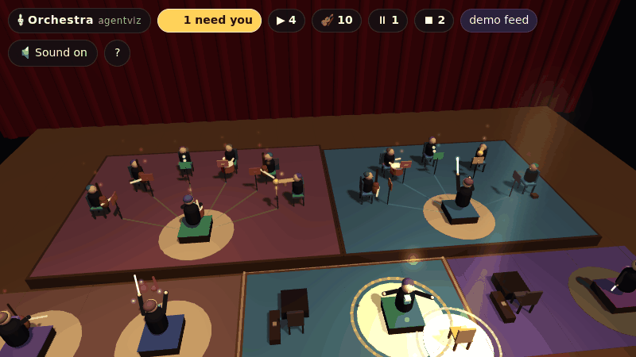
*Six seconds of Wren's and Otto's ensembles: bows moving, sticks hitting, notes rising, Wren's baton beating,
and a bright note popping wherever a new tool call lands.*

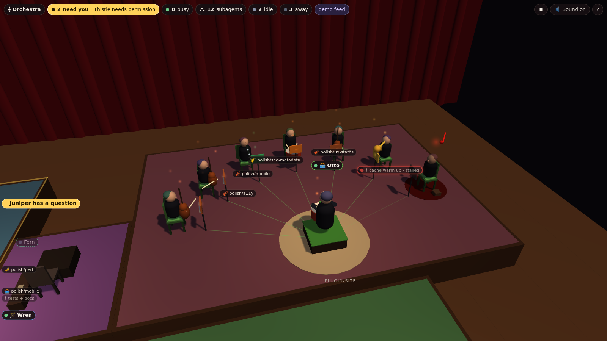
*A lead with its subagents: Otto (running a command) and seven musicians fanned in front of the podium, each
stand naming its lane and tied back to the podium by a faint thread. "cache warm-up" (right) has stalled: its
instrument is on the floor and its chair flashes red under a wrong note.*


*Needs you, for a permission prompt: Thistle has turned to the owner's seat, arms open, a gold padlock over its
head. The solo chair beside the podium sits in a bright spotlight and rings pulse round both.*

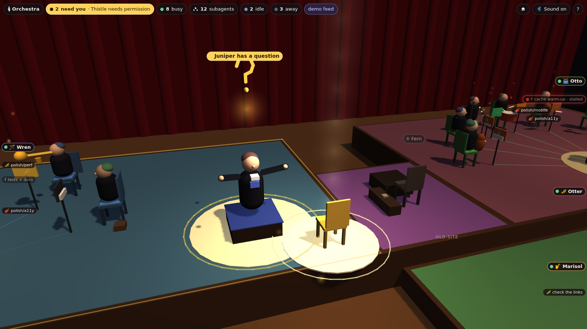
*Needs you, for a question: Juniper, a gold "?" over its head.*

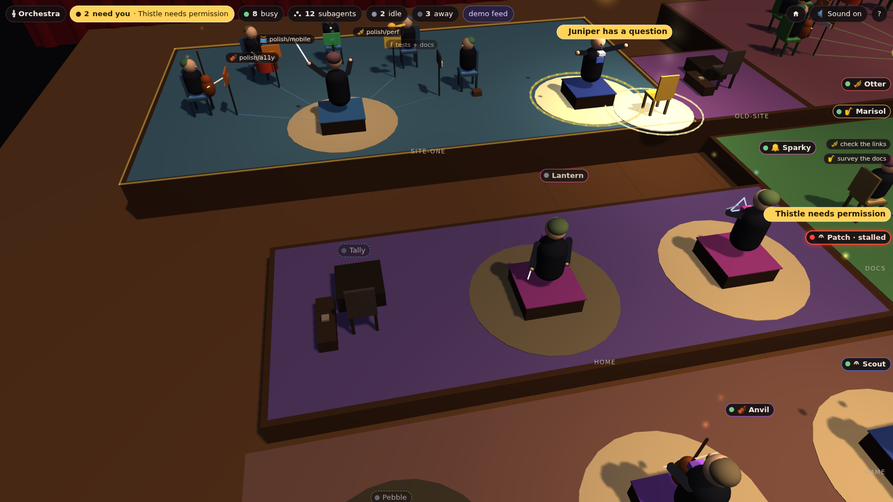
*Idle and offline: Lantern stands with arms by its sides and the baton lowered under a dim pool; Tally is
offline, an empty chair and a closed instrument case, no spotlight.*

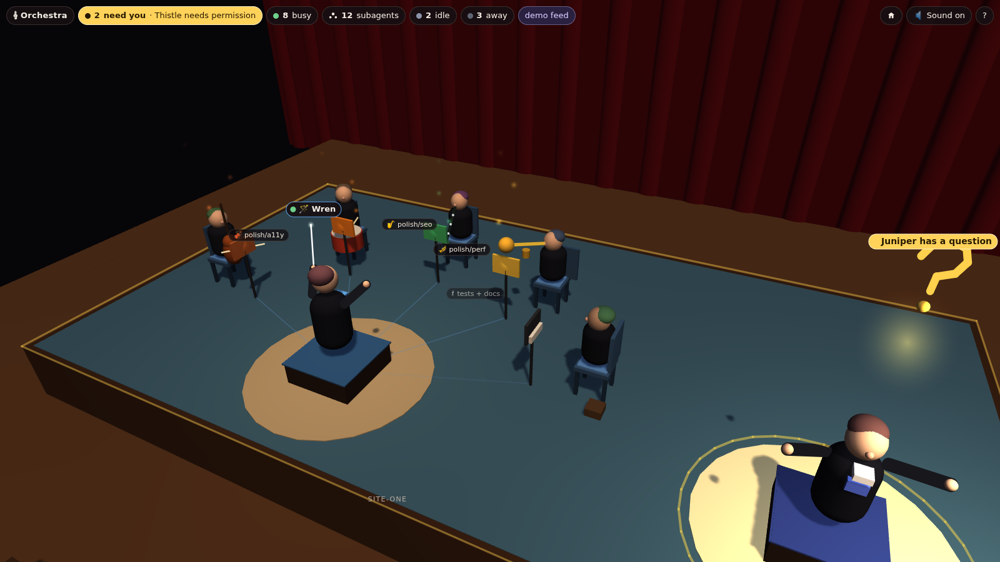
*A resting subagent: in Wren's ensemble "tests + docs" has put its instrument on the floor and its stand is
dark, while the others play and Wren beats time with the baton.*

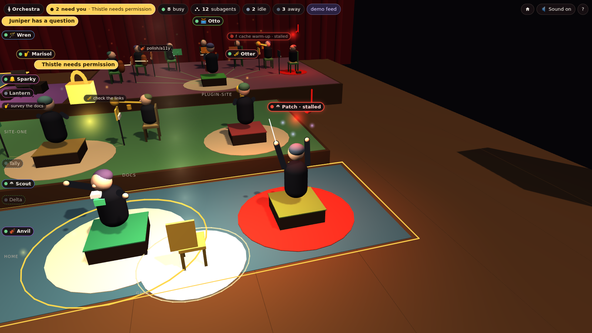
*Stalled: Patch is busy but has written nothing for over five minutes, so its podium flashes red with a red
wrong note above it. Its hands are held up still: a thinking pause.*

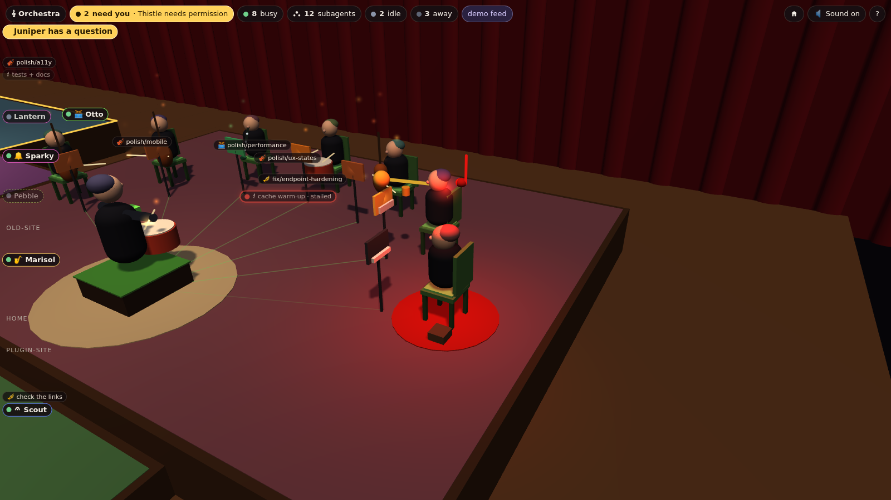
*A stalled subagent: Otto's "cache warm-up" lane, quiet too long without finishing.*

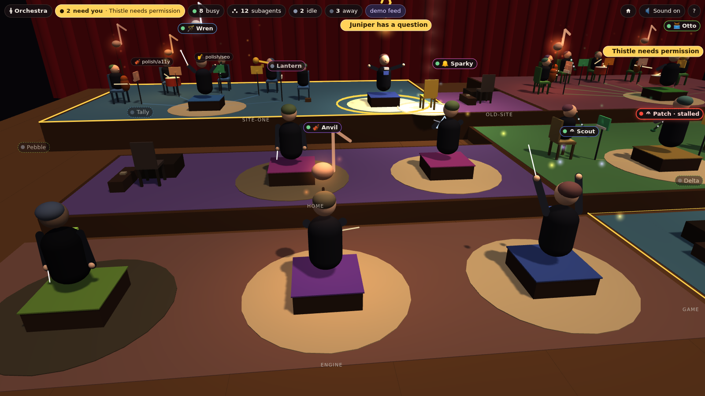
*New tool calls: a bright note pops up beside Anvil and fades as it rises; behind, musicians in Wren's and
Otto's ensembles pop theirs. With Sound on, each also plays one soft note.*

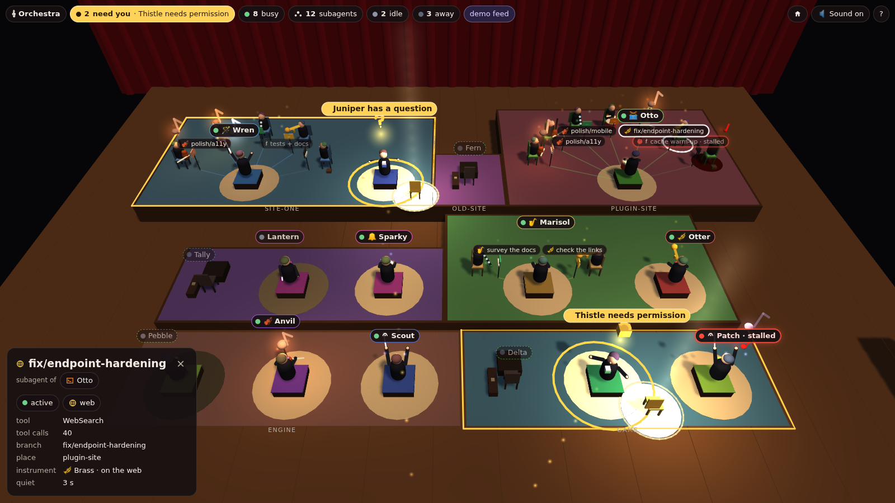
*Tap any conductor, musician or empty chair: the card shows its state, instrument, tool, tool calls and
branch (here Otto's `fix/endpoint-hardening` lane, on its own branch), and for a conductor every musician
as a chip you can tap to jump to it.*

<p>
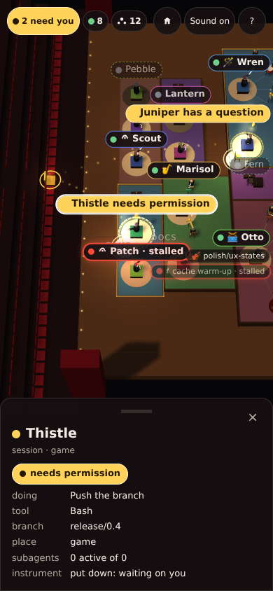

</p>

*On a phone (390 x 844): the top bar keeps to one line (need you, busy, subagents and the buttons); the card is
a bottom sheet (left, open on Thistle, slid clear above it); in portrait the stage is seen from the wings so its
long side runs up the screen (right); drag to orbit, pinch to zoom, two fingers to pan.*

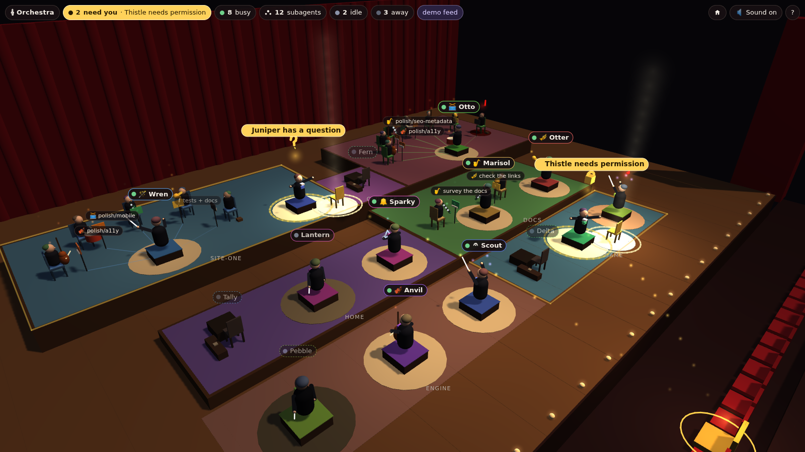
*From the wings, low: the risers step up for the back rows.*

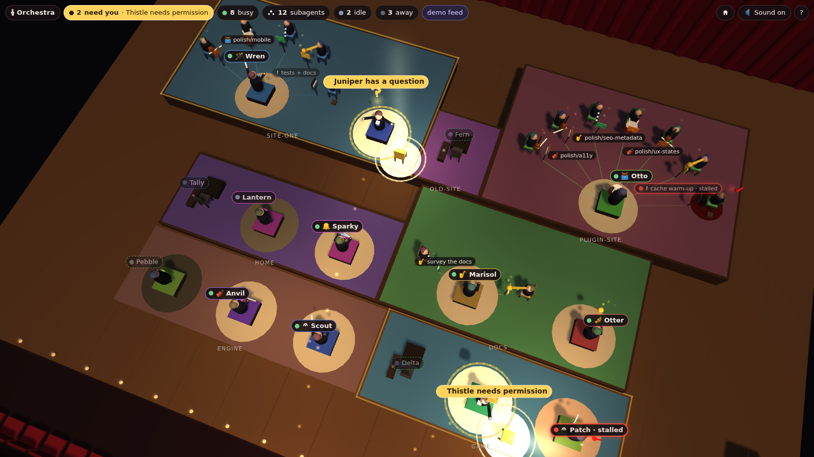
*From above: each ensemble's fan, its stands and threads read as one group.*

## Sound (off by default)

Press **Sound on** (top right) to hear the orchestra. Nothing plays, and no
audio context is created, until you do. Then each new tool call plays one
short, soft note in its family's timbre (bowed strings, a soft drum, a breathy
woodwind, a brass swell, a small bell for the baton, a plucked triangle for
other tools), pitched on a pentatonic scale so it never clashes, at the moment
its note pops on stage; a snapshot's calls are spread over a second and a half
rather than struck as one chord. While anyone needs you, a gentle two-note
chime repeats every six seconds. Notes are rate-limited (at most six in three
seconds) and quiet. On the demo feed the busy agents make a new call every few
polls so there is something to hear. **Sound on** is a toggle: it lights gold
while pressed (and says so to a screen reader); press it again to stop.

## Build and test

```bash
python3 -m unittest discover -s tests       # serves the fixture; page, assets, feed, vendored PINs, hygiene
npm ci && npx playwright install chromium   # Playwright 1.61.1, for the browser tests
pip install -r requirements-dev.txt         # Pillow, for the GIF
npm run smoke                               # headless Chromium on the demo feed; saves docs/media/screenshot.png
npm run screenshots                         # every image above (or some: npm run screenshots -- hero phone motion)
EMSDK=/path/to/emsdk vendor/agentviz-kit/scene/build-scene.sh scene/kit.conf   # rebuild web/orchestra-engine.*
```

The built engine files are committed, so serving needs only Python. Tests
use port 9129 (`ORCHESTRA_TEST_PORT` overrides). `vendor/agentfeed/`,
`vendor/agentviz-kit/` and `web/agentviz-*` come from
[agentviz](https://github.com/dmccoystephenson/agentviz) (`tools/vendor-kit.sh`);
do not edit them here.

## How it works

The feed client, the HUD (chips, the selected-agent card and bottom sheet,
the banner), world labels, tap picking and the page-to-engine data format are
the shared agentviz kit (docs/KIT.md in agentviz). On top of it,
`web/orchestra-stage.js` keys everything by id, lays the ensembles out in rows
on risers, fans each session's musicians in front of its podium and eases
every figure; new tool calls from the feed client's diff become notes timed
in scene time. Each frame `web/orchestra-frame.js` packs the stage in the
agentviz wire format; `scene/main.cpp` decodes it with `agentviz.h` and draws
it with Strata's primitives, lines, points and point lights (`hall.h`,
`conductor.h`, `musician.h`, `instruments.h`). `web/orchestra-audio.js` is the
opt-in Web Audio band.

## Licence

Code: [MIT](LICENSE). Screenshots and GIFs in `docs/media/`:
[CC0 1.0](LICENSE-media). The committed engine bundles Strata (MIT) and its
libraries, and the Emscripten runtime: see
[THIRD_PARTY_NOTICES.md](THIRD_PARTY_NOTICES.md).
